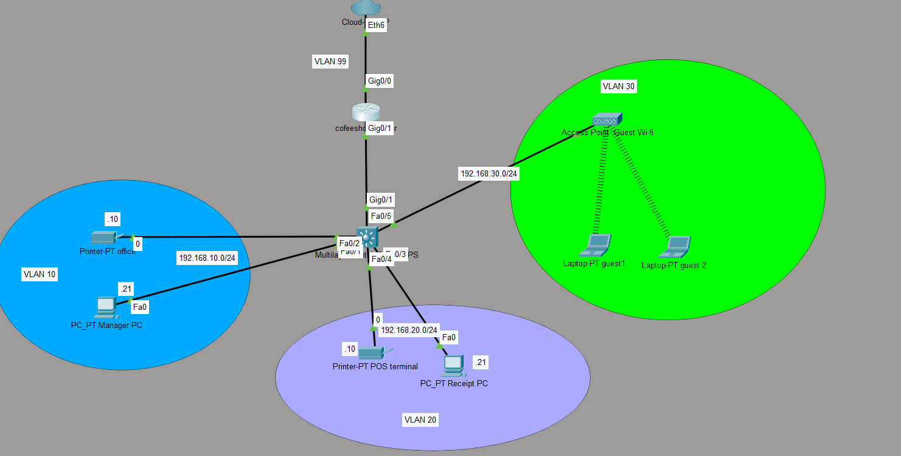

# ☕ Coffee Shop Network: VLAN Segmentation & Inter-VLAN Routing (Cisco Packet Tracer)


A small-business network design for a coffee shop, built and tested in **Cisco Packet Tracer**. It segments the shop into separate VLANs (management office, POS, guest Wi-Fi, and network management), routes between them with **router-on-a-stick**, hands out addresses via **DHCP**, restricts guest traffic with an **extended ACL**, and secures device access with **SSH** and a hashed enable secret.

> **📌 Project type:** This is a **personal, home-based lab project** that I designed, built, and troubleshot on my own to practise and demonstrate core networking skills. It is a simulation, not a production deployment.

---

## 📑 Table of Contents

1. [Project Goals](#-project-goals)
2. [Network Design](#-network-design)
3. [VLAN & IP Addressing Plan](#-vlan--ip-addressing-plan)
4. [Devices Used](#-devices-used)
5. [Configuration Highlights](#-configuration-highlights)
6. [DHCP & DNS](#-dhcp--dns)
7. [Security Hardening](#-security-hardening)
8. [Troubleshooting Log](#-troubleshooting-log)
9. [Verification Commands](#-verification-commands)
10. [How to Run This Lab](#-how-to-run-this-lab)
11. [Repository Structure](#-repository-structure)
12. [Skills Demonstrated](#-skills-demonstrated)
13. [Possible Future Improvements](#-possible-future-improvements)

---

## 🎯 Project Goals

- Separate business-critical traffic (POS) from customer traffic (guest Wi-Fi) for security and performance.
- Provide inter-VLAN routing through a single router uplink (router-on-a-stick).
- Automate addressing with per-VLAN DHCP pools, reserving a block of addresses for static devices.
- Prevent guest devices from reaching internal VLANs using an extended access list.
- Secure remote administration (SSH only, no Telnet; hashed privileged password).

---

## 🗺 Network Design



The coffee shop router connects to the ISP cloud on `Gig0/0` and to the switch on `Gig0/1`, which carries all VLANs over a single 802.1Q trunk. The switch connects each VLAN's devices on its own access ports, and the guest Wi-Fi access point on `Fa0/5` serves the wireless guest laptops. In the diagram, the printers use host address `.10` and the PCs use `.21` in their respective subnets.

---

## 📊 VLAN & IP Addressing Plan

| VLAN ID | Name | Subnet | Gateway | Purpose / Devices |
|:-------:|------|--------|---------|-------------------|
| **10** | `MANAGEMENT_OFFICE` | 192.168.10.0/24 | 192.168.10.1 | Manager's PC, office printer |
| **20** | `POS` | 192.168.20.0/24 | 192.168.20.1 | POS terminal, receipt printer |
| **30** | `GUEST` | 192.168.30.0/24 | 192.168.30.1 | Guest laptops via wireless AP |
| **99** | `NETWORK_MANAGEMENT` | 192.168.99.0/24 | 192.168.99.1 | Switch/router management traffic |

### Switch Port Assignment

| Port(s) | VLAN | Mode | Connected to |
|---------|:----:|------|--------------|
| Fa0/1 – Fa0/2 | 10 | access + portfast | Management office devices |
| Fa0/3 – Fa0/4 | 20 | access + portfast | POS devices |
| Fa0/5 | 30 | access + portfast | Guest wireless AP |
| Gig0/1 | 10, 20, 30, 99 | 802.1Q trunk | Router (`TO_Coffee_RTR`) |

The switch management interface is **VLAN 99** (`192.168.99.2/24`) with default gateway `192.168.99.1`.

> The AP port (Fa0/5) is an **access** port, not a trunk, because the access point does not tag frames.

> 💡 **Advice for expansion:** You can pre-assign additional unused switch ports to each VLAN (for example with `interface range`) so that new devices can simply be plugged in later without touching the switch configuration.

---

## 🖥 Devices Used

| Device | Role | Model (Packet Tracer) |
|--------|------|-----------------------|
| Coffeeshop Router | Inter-VLAN routing, DHCP, internet edge | Cisco 2911 / 1941 |
| Coffeeshop Switch | Access-layer switching, VLAN trunking | Cisco 3560 |
| Guest WiFi AP | Wireless access for guest VLAN | Access Point-PT |
| Manager's PC | Office/management endpoint | PC-PT |
| POS Terminal | Point-of-sale endpoint | PC-PT |
| Office Printer | Shared office printer | Printer-PT |
| Receipt Printer | POS receipt printer | Printer-PT |
| Guest 1 / Guest 2 | Guest wireless clients | Laptop-PT |

---

## ⚙ Configuration Highlights

> Excerpts of the key configuration are shown below. Full versions are in the `configs/` folder.

### Router: Subinterfaces (Router-on-a-Stick)

`Gig0/1` is split into one subinterface per VLAN, each with `encapsulation dot1Q <vlan-id>` and its own gateway IP. The physical interface carries no IP address and must be brought up with `no shutdown`.

```cisco
interface GigabitEthernet0/0
 description TO_ISP
!
interface GigabitEthernet0/1
 description TO_SW
 no shutdown
!
interface GigabitEthernet0/1.10
 description Management_office_Gateway
 encapsulation dot1Q 10
 ip address 192.168.10.1 255.255.255.0
!
interface GigabitEthernet0/1.20
 description POS_Gateway
 encapsulation dot1Q 20
 ip address 192.168.20.1 255.255.255.0
!
interface GigabitEthernet0/1.30
 description Guest_Gateway
 encapsulation dot1Q 30
 ip address 192.168.30.1 255.255.255.0
 ip access-group Guest_Restrictions in
!
interface GigabitEthernet0/1.99
 description Network_Management_Gateway
 encapsulation dot1Q 99
 ip address 192.168.99.1 255.255.255.0
```

### Switch: Explicit 802.1Q Trunk to Router

```cisco
interface GigabitEthernet0/1
 description TO_Coffee_RTR
 switchport trunk allowed vlan 10,20,30,99
 switchport trunk encapsulation dot1q
 switchport mode trunk
```

> ⚠ **Critical:** `switchport mode trunk` must be set **explicitly**. Defining the trunk encapsulation and allowed VLANs alone is **not enough**; the port stays in its default (access/dynamic) mode and the trunk never forms.

### Switch: Access Ports

```cisco
interface FastEthernet0/1
 description Management_Office_Devices
 switchport access vlan 10
 switchport mode access
 spanning-tree portfast
!
interface FastEthernet0/2
 description Management_Office_Devices
 switchport access vlan 10
 switchport mode access
 spanning-tree portfast
!
interface FastEthernet0/3
 description POS_Devices
 switchport access vlan 20
 switchport mode access
 spanning-tree portfast
!
interface FastEthernet0/4
 description POS_Devices
 switchport access vlan 20
 switchport mode access
 spanning-tree portfast
!
interface FastEthernet0/5
 description Guest-Devices
 switchport access vlan 30
 switchport mode access
 spanning-tree portfast
```

### Switch: Management Interface

```cisco
interface Vlan1
 no ip address
 shutdown
!
interface Vlan99
 description SW_Management
 ip address 192.168.99.2 255.255.255.0
!
ip default-gateway 192.168.99.1
```

---

## 🌐 DHCP & DNS

Each of the user VLANs (10, 20, 30) has its own DHCP pool on the router. The first 20 addresses of every subnet are **excluded** from the pool so they stay available for the gateway and for statically addressed devices (printers, infrastructure, etc.).

```cisco
ip dhcp excluded-address 192.168.10.1 192.168.10.20
ip dhcp excluded-address 192.168.20.1 192.168.20.20
ip dhcp excluded-address 192.168.30.1 192.168.30.20
```

Each pool hands out its VLAN's gateway as the default router and **Google Public DNS (`8.8.8.8`)** as the DNS server:

```cisco
ip dhcp pool Management_Office
 network 192.168.10.0 255.255.255.0
 default-router 192.168.10.1
 dns-server 8.8.8.8
!
ip dhcp pool POS
 network 192.168.20.0 255.255.255.0
 default-router 192.168.20.1
 dns-server 8.8.8.8
!
ip dhcp pool Guest
 network 192.168.30.0 255.255.255.0
 default-router 192.168.30.1
 dns-server 8.8.8.8
```

VLAN 99 (network management) is intended for infrastructure devices and uses static addressing.

---

## 🔒 Security Hardening

| Control | Implementation |
|---------|----------------|
| Privileged EXEC password | `enable secret` (stored as a **Type 5** hash, not plaintext) |
| Remote access | VTY lines use `login local` with `transport input ssh` (**Telnet disabled**) |
| Traffic segmentation | Guest traffic isolated in its own VLAN, separate from office, POS and management |
| Guest ACL | Extended ACL `Guest_Restrictions` applied inbound on the guest subinterface |
| Trunk hygiene | Only VLANs 10, 20, 30, 99 allowed on the trunk |
| Login banner | MOTD warning: "Unauthorized access is prohibited" |
| Unused ports | Router `Gig0/2` and switch `Vlan1` administratively shut down |

### Guest VLAN Access Control List

The guest VLAN may use DHCP and reach the internet, but is blocked from every internal subnet:

```cisco
ip access-list extended Guest_Restrictions
 permit udp any eq bootpc any eq bootps
 deny ip 192.168.30.0 0.0.0.255 192.168.10.0 0.0.0.255
 deny ip 192.168.30.0 0.0.0.255 192.168.20.0 0.0.0.255
 deny ip 192.168.30.0 0.0.0.255 192.168.99.0 0.0.0.255
 permit ip 192.168.30.0 0.0.0.255 any
```

The first line keeps DHCP working for guests; the three `deny` lines isolate management, POS and network-management VLANs; the final `permit` allows everything else (internet access).

### SSH Setup

```cisco
enable secret <your-password>
username <admin-user> secret <your-password>
ip domain-name coffeeshop.local
crypto key generate rsa modulus 2048
ip ssh version 2
!
banner motd ^C
Unauthorized access is prohibited^C
!
line vty 0 4
 login local
 transport input ssh
line vty 5 15
 login local
 transport input ssh
```

---

## 🛠 Troubleshooting Log

Real issues hit during the build, how they were found, and how they were fixed.

### Issue 1: PCs could not ping anything

- **Symptom:** End devices could not reach their gateway or any other device.
- **Root cause:** The router and switch were configured correctly, but the end devices still held **stale IP settings** (no valid lease / APIPA `169.254.x.x`). They had never renewed their configuration after the DHCP pools and VLANs came online.
- **Fix:** Renewed the IP configuration on each end device (set the interface to static then back to **DHCP**, or run `ipconfig /renew` in the Command Prompt), then re-tested with `ipconfig` and `ping`.
- **Lesson / best practice:** After finishing router and switch config, **always refresh addressing on the end devices**. Better still, follow a bottom-up check order:
  1. Verify physical/Layer 1-2 state first (`show ip interface brief`, `show vlan brief`, `show interfaces trunk`).
  2. Confirm DHCP is handing out leases (`show ip dhcp binding`).
  3. **Then** renew the client IP and test: client → own gateway → other VLAN gateway → external IP.

### Issue 2: Router `Gig0/1` interface was down

- **Symptom:** `show ip interface brief` showed `Gig0/1` as **administratively down**, so none of the subinterfaces came up.
- **Root cause:** Router interfaces are **shut down by default**. The `no shutdown` command had been forgotten on the physical interface.
- **Fix:**
  ```cisco
  interface GigabitEthernet0/1
   no shutdown
  ```
- **Lesson:** Subinterfaces depend on the parent physical interface. If the parent is down, they are down too. Always check the parent interface first.

### Issue 3 (design note): Trunk not forming

- **Cause to watch for:** Setting `switchport trunk encapsulation` and `switchport trunk allowed vlan` without `switchport mode trunk` leaves the port in access mode.
- **Fix:** Explicitly configure `switchport mode trunk` on the uplink port.

### Quick troubleshooting checklist

| Check | Command | What to look for |
|-------|---------|------------------|
| Interface status | `show ip interface brief` | Status `up` / Protocol `up` (not `administratively down`) |
| VLANs & port membership | `show vlan brief` | Ports in the right VLANs |
| Trunk state | `show interfaces trunk` | Gig0/1 trunking, VLANs 10, 20, 30, 99 allowed |
| Subinterfaces / gateways | `show ip route` | Connected routes for all four subnets |
| DHCP leases | `show ip dhcp binding` | Clients receiving addresses in the correct range |
| ACL hits | `show access-lists` | Match counters increasing on the expected lines |
| Client side | `ipconfig /all`, `ping` | Correct IP, gateway, DNS |

---

## ✅ Verification Commands

```cisco
show ip interface brief
show vlan brief
show interfaces trunk
show ip route
show ip dhcp binding
show access-lists
show running-config
```

Connectivity tests to run from the clients:

- Ping own gateway (e.g., `192.168.10.1`)
- Ping a device in another VLAN from the office or POS VLAN (confirms inter-VLAN routing)
- Ping from a **guest** laptop to a device in VLAN 10, 20 or 99 (should be **blocked** by the ACL)
- Ping `8.8.8.8` (confirms edge/DNS settings are reachable in the lab)

---

## 🚀 How to Run This Lab

### 1. Download Cisco Packet Tracer (free)

1. Create a free account at **[Cisco Networking Academy (netacad.com)](https://www.netacad.com/)**.
2. Enroll in the free **"Introduction to Packet Tracer"** course, which gives access to the download.
3. Download the installer for your OS (Windows / macOS / Linux) and install it.
4. Sign in with your Networking Academy account when prompted.

### 2. Clone this repository

Click the green **Code** button at the top of this repository, copy the HTTPS URL, then run:

```bash
git clone <repository-url>
```

Or simply click **Code → Download ZIP** and extract it.

### 3. Open the project

1. Launch **Cisco Packet Tracer**.
2. Go to **File → Open** and select the `.pkt` file from the `packet-tracer/` folder.
3. Open the CLI of each device to inspect the configuration, or paste the configs from `configs/`.

### 4. Test it yourself

1. Make sure end devices are set to **DHCP**.
2. Wait for link lights to turn green (portfast speeds this up), then renew the IP config on each end device.
3. Run the [verification commands](#-verification-commands) and ping tests.

---

## 📁 Repository Structure

```
.
├── README.md
├── packet-tracer/
│   └── coffeeshop-network.pkt
├── configs/
│   ├── router-config.txt
│   └── switch-config.txt
└── docs/
    └── topology.png
```

---

## 🧠 Skills Demonstrated

- VLAN design and segmentation (802.1Q)
- Router-on-a-stick inter-VLAN routing with subinterfaces
- Trunk and access port configuration, PortFast
- DHCP pools, excluded ranges, and DNS assignment
- Extended ACLs for guest isolation
- IP subnetting and addressing plans
- Device hardening: hashed secrets, SSH-only remote access, login banner
- Systematic troubleshooting and documentation

---

## 🔮 Possible Future Improvements

- Configure **NAT/PAT** for internet access
- Add **port security** on access ports
- Pre-assign spare ports per VLAN for easy expansion
- Introduce a second switch with **EtherChannel** / redundancy
- Add **WPA2** security on the guest AP and a captive-portal style setup
- Add **syslog/SNMP** monitoring on the management VLAN

---

## 👤 Author

**Javeria Ahmad**: Aspiring Network Engineer

> *This is a personal, home-based lab project created for learning and portfolio purposes.*
